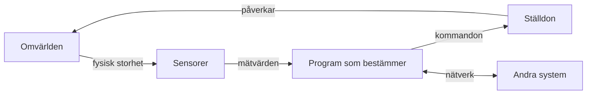

# Kapitel 1: Vad är ett smart system?

> **I det här kapitlet lär du dig**
> - vad som skiljer ett smart system från en vanlig maskin
> - hur du delar upp ett stort tekniskt problem i delar som går att lösa
> - hur du väljer mellan lösningar på ett sätt som går att motivera
> - hur du granskar information innan du bygger något på den

En robotdammsugare kostar mindre än en bra mobil, men den gör något som en vanlig dammsugare inte kan: den märker att den har kört in i en stol och väljer en ny väg. Det är inte en kraftigare motor som gör den intressant. Det är att den mäter, bestämmer och agerar utan att någon håller i den.

Den här boken handlar om just det. Teknikområdet i kursen är **smarta system**: robotik, sensorer, reglering, ROS2, uppkopplade system och säkerhet. Vi börjar med de tankeverktyg som du använder i alla projekt.

## Mäta, bestämma, agera

Ett **system** är delar som samverkar för att uppnå något. Ett **smart system** är ett system som läser av sin omgivning och anpassar sitt beteende efter det. Nästan alla smarta system går att beskriva med samma slinga.

| Del | Uppgift | Exempel i en robotbil |
|---|---|---|
| **Sensor** | gör om en fysisk storhet till ett mätvärde | ultraljudssensor som mäter avstånd |
| **Styrenhet** | kör programmet som fattar beslut | mikrokontroller eller dator |
| **Ställdon** | gör om kommandon till rörelse eller annan påverkan | motor och servo |
| **Kommunikation** | utbyter data med andra system | WiFi och MQTT |

Slingan körs om och om igen, ofta tiotals gånger per sekund. När något i omvärlden ändras ändras mätvärdet, och då ändras beslutet. Det kallas **återkoppling**, och det är den viktigaste skillnaden mellan en smart maskin och en maskin som bara följer en fast sekvens. Vi återkommer till återkoppling i [kapitel 8](08-reglering.md).

Ett smart system är också alltid ett bygge av flera kunskapsområden. Mekaniken måste hålla, elektroniken måste leverera rätt spänning, programmet måste fatta rätt beslut och nätverket måste leverera i tid. De flesta svåra fel uppstår i mötet mellan två delar, inte inuti en av dem.

## Strategier för problemlösning

När ett problem är för stort för att lösas på en gång behöver du en strategi. Fyra strategier återkommer i hela kursen.

| Strategi | Så gör du | Exempel |
|---|---|---|
| **Dela upp** | bryt ner problemet i delar med tydliga gränssnitt | motorstyrning, sensoravläsning och beslut blir separata program |
| **Förenkla först** | lös en enklare version av problemet | kör bilen manuellt innan den ska köra själv |
| **Modellera** | prova idén i en billig modell | testa städlogiken i en simulator före golvet |
| **Isolera** | ändra en sak i taget och jämför | byt bara stoppavståndet mellan två testkörningar |

Lägg märke till att alla fyra handlar om att göra fel billigare. En bugg i en simulator kostar en omstart. Samma bugg på en riktig robot kan kosta en trasig robot.

### Genomgånget exempel: välj städstrategi med en beslutsmatris

Säg att du ska välja hur en städrobot ska täcka ett golv. Du har tre idéer: köra slumpmässigt, köra i spiral eller styra mot ytor som roboten inte har städat. Hur väljer du utan att bara gissa?

En **beslutsmatris** gör valet synligt. Du bestämmer vilka egenskaper som är viktiga, ger varje egenskap en vikt, poängsätter varje alternativ från 1 till 5 och multiplicerar.

| Egenskap | Vikt | Slump | Spiral | Styr mot ostädat |
|---|---|---|---|---|
| Täcker ytan väl | 5 | 3 | 4 | 5 |
| Enkel att bygga | 3 | 5 | 3 | 2 |
| Tål sensorfel | 4 | 4 | 2 | 3 |
| **Summa** | | **46** | **37** | **43** |

Slump får till exempel 3 · 5 + 5 · 3 + 4 · 4 = 15 + 15 + 16 = 46.

Slumpen vinner, men det betyder inte att den är bäst i någon absolut mening. Vikterna är dina egna bedömningar. Sänk vikten för "Enkel att bygga" från 3 till 1, så får du 36, 31 och 39, och då vinner den tredje idén. Det är matrisens verkliga värde: den visar vilka antaganden beslutet vilar på. När du redovisar ett val ska du kunna säga varför vikterna ser ut som de gör.

## Källkritisk informationssökning

När du bygger tekniska lösningar letar du hela tiden efter information: hur en sensor kopplas in, vad en felkod betyder, om ett kodexempel fortfarande fungerar. Fel information kan kosta en bränd komponent eller en förlorad vecka.

Källkritik brukar sammanfattas i fyra frågor. Här är de översatta till tekniskt arbete.

| Fråga | Vad du kontrollerar |
|---|---|
| **Äkthet:** är källan den den utger sig för att vara? | Kommer databladet från tillverkaren, eller är det en kopia på en okänd sida? |
| **Tid:** gäller informationen fortfarande? | Vilken programversion gäller guiden? Kommandon och bibliotek ändras. |
| **Oberoende:** är uppgiften bekräftad av någon annan? | Säger den officiella dokumentationen samma sak som forumet? |
| **Tendens:** har källan ett intresse? | Vill en butik sälja produkten? Är siffran från reklam eller från en mätning? |

I teknik kan du dessutom ofta göra något som historiker inte kan: **prova själv**. Påstår en källa att en sensor mäter ner till 2 cm kan du mäta på 2 cm och se vad som händer.

Så här brukar källor rangordnas när du söker teknisk information, från mest till minst pålitlig:

1. Egen mätning som går att upprepa.
2. Tillverkarens datablad och officiell dokumentation.
3. Standarder, myndigheter och läroböcker.
4. Forum, bloggar och videor från personer med dokumenterad kunskap.
5. Svar från AI-tjänster och okända webbsidor, som du behandlar som tips och alltid kontrollerar.

**Exempel.** I ett forum står det att ultraljudssensorn HC-SR04 mäter upp till 10 meter. I [databladet](https://cdn.sparkfun.com/datasheets/Sensors/Proximity/HCSR04.pdf) står 2 cm till 4 m. Databladet väger tyngst, men det anger också vad tillverkaren lovar under goda förhållanden. Mot en mjuk gardin kan räckvidden bli betydligt kortare. Du skriver därför upp databladets värde som källa och din egen mätning som det du faktiskt bygger på.

Skriv alltid upp var viktiga uppgifter kommer ifrån. Det räcker med en länk och datumet du läste sidan i projektets dokumentation.

## Begrepp

- **System:** delar som samverkar för att uppnå något.
- **Smart system:** system som läser av sin omgivning och anpassar sitt beteende.
- **Sensor:** komponent som gör om en fysisk storhet till ett mätvärde.
- **Ställdon:** komponent som gör om ett kommando till rörelse eller annan påverkan.
- **Återkoppling:** mätvärdet från resultatet används för att justera nästa kommando.
- **Gränssnitt:** den överenskomna kontaktytan mellan två delar av ett system.
- **Beslutsmatris:** tabell där alternativ poängsätts och viktas mot varandra.
- **Källkritik:** systematisk granskning av var information kommer från och hur pålitlig den är.

## Koppling till projektet

Beslutsmatrisen och strategierna används i alla projekt och syns tydligast i [Robotmopp](../projekt/robotmopp/README.md), där du väljer strategi och jämför nivåerna. Källkritiken behövs när du gör komponentlistan. Slingan mäta–bestämma–agera är också utgångspunkten för att förstå [Robot: Humanoiden](../projekt/humanoiden/README.md).

## Läs mer

- [Internetkunskap om källkritik på nätet](https://internetkunskap.se/)
- [Datablad för HC-SR04 (PDF)](https://cdn.sparkfun.com/datasheets/Sensors/Proximity/HCSR04.pdf)

[Innehåll](../README.md) | [Nästa →](02-robotens-kropp.md)
