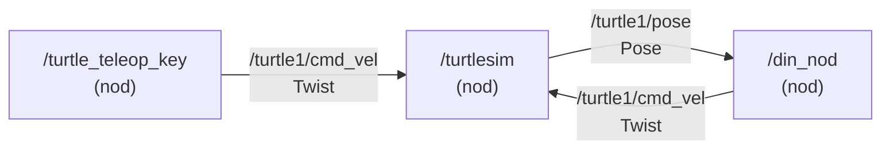

# Kapitel 5: ROS2 och robotens nervsystem

> **I det här kapitlet lär du dig**
> - varför robotprogram delas upp i många små delar
> - vad noder, topics och meddelanden är
> - hur du undersöker ett ROS2-system från terminalen
> - hur en enkel nod i Python är uppbyggd

Tänk dig att du ska skriva ett enda program som läser sensorer, styr motorer, planerar vägen, loggar data och visar en bild. Det blir snabbt omöjligt att felsöka. Därför är de flesta robotar byggda som många små program som pratar med varandra. **ROS2** (Robot Operating System 2) är ett populärt ramverk för just det, och det är inte ett operativsystem trots namnet.

## Noder och topics

ROS2 bygger på några få idéer.

| Begrepp | Betydelse | Liknelse |
|---|---|---|
| **Nod** | ett litet program med ett tydligt ansvar | en person i ett kontrollrum |
| **Topic** | en namngiven kanal för meddelanden | en radiokanal |
| **Meddelande** | data med bestämt format | det som sägs på kanalen |
| **Publisher** | nod som skickar på en topic | den som pratar |
| **Subscriber** | nod som lyssnar på en topic | den som lyssnar |
| **Service** | fråga och svar mellan två noder | ett telefonsamtal |
| **Parameter** | inställning som kan ändras utan att koden ändras | en ratt på en maskin |

Styrkan är att avsändare och mottagare inte behöver känna till varandra. En nod som publicerar styrkommandon bryr sig inte om vem som lyssnar, om det är en simulator eller en riktig robot. Det gör att samma program kan flyttas mellan simulering och verklighet. Det är ett exempel på ett **gränssnitt** som du läste om i [kapitel 1](01-smarta-system.md).



Att två noder båda publicerar på samma topic är tillåtet, men det kan ge krockar. Om både din nod och en fjärrkontroll skickar kommandon till `/turtle1/cmd_vel` kommer roboten att få motstridiga order.

## Turtlesim: en simulator att öva på

**Turtlesim** är en liten simulator med en sköldpadda som ritar streck på skärmen. Den är enkel, men den pratar samma språk som en riktig robot. Det gör den utmärkt att öva på. Kursens [labbserie i ROS2](https://github.com/abbjetmus/ROS2) är skriven för Windows med WSL2 och Ubuntu, och ROS2-versionerna Humble eller Jazzy.

Du undersöker ett körande system med kommandon i terminalen.

```bash
ros2 run turtlesim turtlesim_node        # starta simulatorn
ros2 node list                           # vilka noder finns?
ros2 topic list                          # vilka topics finns?
ros2 topic echo /turtle1/pose            # lyssna på positionen
ros2 interface show geometry_msgs/msg/Twist
```

Meddelandet **Twist** beskriver en önskad rörelse med en linjär och en vinkelhastighet. För en robot på ett golv är det framför allt `linear.x` (framåt) och `angular.z` (rotation runt lodlinjen) som används.

## Genomgånget exempel: en cirkel

Vi publicerar ett kommando från terminalen och räknar ut vad som ska hända.

```bash
ros2 topic pub --rate 10 /turtle1/cmd_vel geometry_msgs/msg/Twist \
  "{linear: {x: 2.0}, angular: {z: 1.8}}"
```

Med `linear.x = 2,0` enheter per sekund och `angular.z = 1,8` radianer per sekund kör sköldpaddan i en cirkel. Sambandet för radien är r = v / ω:

r = 2,0 / 1,8 ≈ 1,11 enheter

Turtlesims värld är ungefär 11 enheter bred. Om du låter den motsvara en arena på 2 m blir en enhet ungefär 2 / 11 ≈ 0,18 m. Då motsvarar radien 1,11 · 0,18 ≈ 0,20 m på golvet, och farten 2,0 enheter/s ungefär 0,36 m/s.

Kommandot publicerar 10 gånger per sekund, alltså en gång var 100:e millisekund, och sköldpaddan kör så länge det håller på.

## En egen nod i Python

En nod i Python, med biblioteket `rclpy`, är en klass med några återkommande delar. Exemplet nedan får en sköldpadda att köra rakt fram tills den kommer för nära högerkanten.

```python
import rclpy
from rclpy.node import Node
from geometry_msgs.msg import Twist
from turtlesim.msg import Pose

class HogerStopp(Node):
    def __init__(self):
        super().__init__('hoger_stopp')
        self.pub = self.create_publisher(Twist, '/turtle1/cmd_vel', 10)
        self.create_subscription(Pose, '/turtle1/pose', self.ny_position, 10)
        self.x = None
        self.create_timer(0.1, self.skicka)

    def ny_position(self, msg):
        self.x = msg.x

    def skicka(self):
        cmd = Twist()
        if self.x is not None and self.x < 9.0:
            cmd.linear.x = 1.0
        self.pub.publish(cmd)

def main():
    rclpy.init()
    rclpy.spin(HogerStopp())
    rclpy.shutdown()
```

Så här läser du koden:

| Del | Vad den gör |
|---|---|
| `create_publisher` | gör noden till avsändare på en topic |
| `create_subscription` | anger vilken funktion som ska köras när ett meddelande kommer |
| `create_timer` | kör `skicka` regelbundet, här tio gånger per sekund |
| `ny_position` | en **callback**, en funktion som systemet anropar när något hänt |
| `rclpy.spin` | håller noden igång och kör callbackar när det behövs |

Lägg märke till uppdelningen. Callbacken sparar det senaste mätvärdet, och timern fattar beslut och publicerar. Innan det första värdet har kommit är `self.x` lika med `None`, och då skickas ett tomt kommando, så roboten står stilla. En robot som inte vet något ska inte röra sig.

Paket byggs med verktyget `colcon` i en arbetsmapp, en **workspace**, vilket du gör steg för steg i labbarna. Efter bygget behöver du köra `source install/setup.bash` för att terminalen ska hitta dina paket.

## Hitta felet med verktygen

När något inte fungerar är det sällan din kod du ska titta på först.

| Symtom | Kommando | Vad du letar efter |
|---|---|---|
| Inget händer | `ros2 node list` | Kör noden alls? |
| Fel data | `ros2 topic echo <topic>` | Ser värdena rimliga ut? |
| Långsamt | `ros2 topic hz <topic>` | Kommer meddelanden i väntad takt? |
| Inga kopplingar | `ros2 topic info <topic> -v` | Stämmer antal publishers och subscribers och deras QoS? |

**QoS** (Quality of Service) styr hur meddelanden levereras, till exempel om de får tappas. Om en nod verkar skicka men ingen tar emot kan det bero på att QoS-inställningarna inte stämmer. Dokumentationen beskriver det närmare.

## Begrepp

- **ROS2:** ramverk för att bygga robotprogram av samverkande delar.
- **Nod:** ett program med ett tydligt ansvar i ett ROS2-system.
- **Topic:** namngiven kanal som meddelanden skickas på.
- **Twist:** meddelandetyp som beskriver önskad linjär och vinkelhastighet.
- **Callback:** funktion som anropas när något händer.
- **Workspace:** mapp där du bygger dina ROS2-paket.
- **Teleop:** fjärrstyrning av en robot, ofta med tangentbordet.
- **QoS:** inställningar som styr leveransen av meddelanden.

## Koppling till projektet

Kapitlet förbereder [Robotik: Sköldpaddan](../projekt/skoldpaddan/README.md), där kursens material är labbarna 1 till 7 i ROS2-repot. Allt du lär dig om noder och topics återanvänds i [Robotmopp](../projekt/robotmopp/README.md).

## Läs mer

- [Officiell dokumentation för ROS2 Jazzy](https://docs.ros.org/en/jazzy/)
- [Introduktion till turtlesim](https://docs.ros.org/en/jazzy/Tutorials/Beginner-CLI-Tools/Introducing-Turtlesim/Introducing-Turtlesim.html)
- [Om noder](https://docs.ros.org/en/jazzy/Concepts/Basic/About-Nodes.html) och [om topics](https://docs.ros.org/en/jazzy/Concepts/Basic/About-Topics.html)
- [Quality of Service-inställningar](https://docs.ros.org/en/jazzy/Concepts/Intermediate/About-Quality-of-Service-Settings.html)
- [Kursens labbserie](https://github.com/abbjetmus/ROS2)

[← Föregående](04-sakerhet-och-ctf.md) | [Innehåll](../README.md) | [Nästa →](06-simulering-och-tillstand.md)
