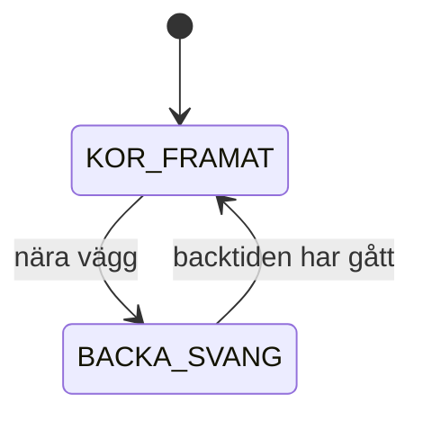

# Kapitel 6: Simulering och tillståndsmaskiner

> **I det här kapitlet lär du dig**
> - varför du simulerar innan du testar på riktigt
> - vad en tillståndsmaskin är och hur du skriver en
> - hur du mäter hur väl en robot täcker en yta
> - vad simuleringen inte kan berätta

Att köra en robot rakt in i en vägg är dyrt. Att köra en simulerad robot rakt in i en simulerad vägg kostar en omstart. Därför börjar nästan all seriös robotutveckling i en simulator. Men en simulering är alltid en förenkling, och den stora konsten är att veta vad den inte visar.

## Varför simulera?

En **simulering** är en modell av ett system som du kan köra och experimentera med. Den ger dig tre saker: du kan testa utan att riskera hårdvara, du kan upprepa exakt samma försök och du kan mäta sådant som är svårt att mäta i verkligheten.

Skillnaden mellan hur något beter sig i simuleringen och i verkligheten brukar kallas **sim-to-real-gapet**. Jämförelsen mellan turtlesim och en servostyrd bil visar var gapet finns.

| Egenskap | Turtlesim | Riktig bil |
|---|---|---|
| Position | känd exakt | okänd, bara avstånd rakt fram |
| Sensor | störningsfri och snabb | brusig, spikar och långsammare |
| Sväng | kan vrida sig på stället | svänger bara medan den rullar |
| Tid | kommandon verkar direkt | fördröjning och rullsträcka |

Simuleringen är alltså bra för att testa logiken, men dålig för att ställa in exakta tal. Därför behöver du mäta på den riktiga bilen när du väl kommer dit.

## Tillståndsmaskiner

Ett robotprogram behöver ofta göra olika saker beroende på vad det håller på med. Ett bra sätt att hålla ordning på det är en **tillståndsmaskin**. Den består av ett antal **tillstånd**, och den byter mellan dem när bestämda villkor uppfylls. Bytena kallas **övergångar**. Maskinen är i exakt ett tillstånd i taget.

Vi tar ett beteende för en städrobot som inte kan svänga på stället: den kör framåt tills den är nära en vägg, backar sedan under en bestämd tid med svängen på och kör framåt igen.



Skriven i Python, utan ROS2, så att du kan köra den var som helst, ser logiken ut så här.

```python
KOR_FRAMAT = "kor_framat"
BACKA_SVANG = "backa_svang"
BACKA_TID = 1.5
FART = 0.4

class Stadare:
    def __init__(self):
        self.tillstand = KOR_FRAMAT
        self.backa_start = None

    def steg(self, nara_vagg, tid):
        """Returnerar (linear_x, angular_z) utifrån sensorn och tiden."""
        if self.tillstand == KOR_FRAMAT and nara_vagg:
            self.tillstand = BACKA_SVANG
            self.backa_start = tid

        if self.tillstand == BACKA_SVANG:
            if tid - self.backa_start < BACKA_TID:
                return (-FART, 1.0)
            self.tillstand = KOR_FRAMAT
        return (FART, 0.0)

s = Stadare()
assert s.steg(False, 0.0) == (0.4, 0.0)
assert s.steg(True, 1.0) == (-0.4, 1.0)
assert s.steg(False, 2.0) == (-0.4, 1.0)
assert s.steg(False, 2.6) == (0.4, 0.0)
print("alla tester gick igenom")
```

Tre saker är värda att lägga märke till.

- Logiken är skild från ROS2. Det betyder att du kan testa den med vanliga `assert`-rader, utan robot och utan simulator.
- Tiden skickas in som ett värde. Då kan du testa vad som händer vid exakt 2,6 sekunder utan att vänta.
- Varje rad i testet beskriver ett krav. Den sista raden säger: när backtiden gått ska roboten köra framåt igen.

Om du lägger till fler beteenden, till exempel ett tillstånd som kör spiral, lägger du till ett tillstånd och dess övergångar. Du skriver inte in fler nästlade `if`-satser på måfå.

## Genomgånget exempel: mäta täckning

Om en städrobot ska vara bra måste du kunna säga hur bra. Ett mått är **täckningsgrad**: hur stor andel av ytan som roboten har besökt. Dela upp arenan i ett rutnät, till exempel 8 × 8 rutor, och håll reda på vilka som besökts.

Turtlesims arena är ungefär 11 enheter bred. Då räknas en position om till en rutas nummer så här:

```python
ARENA = 11.0
RUTOR = 8

def ruta(position):
    return min(RUTOR - 1, max(0, int(position / ARENA * RUTOR)))

print(ruta(3.2))    # 2
print(ruta(10.9))   # 7
print(ruta(5.5))    # 4
```

För positionen 3,2 är beräkningen 3,2 / 11 · 8 ≈ 2,33, och `int` hugger av till 2. Funktionerna `min` och `max` ser till att en position utanför arenan inte ger ett ogiltigt index.

Om roboten har besökt 58 av 64 rutor är täckningsgraden 58 / 64 ≈ 90,6 %.

## Slump eller system?

En slumpmässig strategi är enkel att bygga, men hur effektiv är den? Vi kan ta reda på det med en förenklad simulering där en robot flyttar en ruta i taget på ett 8 × 8-rutnät.

```python
import random
from statistics import median

def slumpsteg(seed):
    r = random.Random(seed)
    position = (0, 0)
    besokta = {position}
    steg = 0
    while len(besokta) < 64:
        dx, dy = r.choice([(1, 0), (-1, 0), (0, 1), (0, -1)])
        ny = (position[0] + dx, position[1] + dy)
        steg += 1
        if 0 <= ny[0] < 8 and 0 <= ny[1] < 8:
            position = ny
            besokta.add(position)
    return steg

varden = [slumpsteg(i) for i in range(2000)]
print("median:", median(varden))
```

När det här skriptet kördes blev medianen av 2000 försök ungefär 700 steg. En robot som kör i rader, sicksack, klarar samma yta på 63 steg (64 rutor, 63 förflyttningar). Modellen är grov, men den visar något viktigt: slumpen betalar sin enkelhet med mycket tid, och den tar längst tid på de sista rutorna.

En sicksack-strategi förutsätter dock att roboten vet var den är. Har roboten bara en avståndssensor rakt fram är sicksack svår att köra, och då kan slumpen vara det bästa valet. Sådana avvägningar är precis det du ska kunna motivera i en rapport.

## Från simulator till verklighet

När logiken fungerar i simulatorn flyttar du den till roboten. Några vanor gör flytten lättare.

1. **Håll samma gränssnitt.** Använd samma topics så att bara kopplingen mot hårdvaran byts ut.
2. **Gör inställningar till parametrar**, så att du kan trimma utan att bygga om.
3. **Skriv ner vad du tror kommer att hända** innan du provar på riktigt. Jämför sedan.
4. **Starta försiktigt:** låg fart och roboten upplyft tills du vet att riktningarna stämmer.

En **launch-fil** i ROS2 startar flera noder med ett enda kommando, vilket gör försöken lättare att upprepa på samma sätt varje gång.

## Begrepp

- **Simulering:** körning av en modell av ett system.
- **Sim-to-real-gap:** skillnaden mellan simulerat och verkligt beteende.
- **Tillstånd:** ett av de lägen som en tillståndsmaskin kan befinna sig i.
- **Övergång:** byte mellan två tillstånd när ett villkor uppfylls.
- **Täckningsgrad:** andel av en yta som besökts.
- **Parameter:** värde som kan ändras utan att koden skrivs om.
- **Launch-fil:** fil som startar flera ROS2-noder samtidigt.

## Koppling till projektet

Täckningsmätning och tillståndsmaskiner används i [Robotmopp](../projekt/robotmopp/README.md), i första hand i labb 8 och labb 10. Grunderna tränar du i [Robotik: Sköldpaddan](../projekt/skoldpaddan/README.md).

## Läs mer

- [Labb 7 om tillståndsmaskiner](https://github.com/abbjetmus/ROS2/blob/main/labs/labb-7-vagg-undvikare.md)
- [Labb 8 om robotmoppen i simulering](https://github.com/abbjetmus/ROS2/blob/main/labs/labb-8-robotmopp-simulering.md)

[← Föregående](05-ros2.md) | [Innehåll](../README.md) | [Nästa →](07-uppkopplade-system.md)
