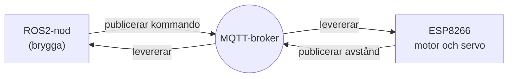

# Kapitel 7: Uppkopplade system och MQTT

> **I det här kapitlet lär du dig**
> - hur MQTT skiljer sig från att skicka meddelanden direkt
> - hur en brygga kopplar ROS2 till en mikrokontroller
> - hur stor fördröjning som är acceptabel och varför
> - varför ett dödmansgrepp ska sitta i bilen och inte i datorn

En mikrokontroller som ESP8266 kostar några tior och kan ändå prata med hela världen. Det gör att den billigaste delen av en robot kan vara uppkopplad. Men allt som går över nätet kan bli sent, försvinna eller komma från fel avsändare, och det måste systemet klara.

## MQTT

**MQTT** är ett lättviktigt protokoll där enheter kommunicerar via en central server som kallas **broker**. Ingen enhet behöver veta var de andra finns. Alla pratar med brokern, och brokern ser till att meddelanden når dem som prenumererar.

Du känner igen idén från ROS2: en avsändare publicerar på ett ämne, och mottagarna prenumererar. Ämnen i MQTT kallas också **topics** och skrivs med snedstreck, till exempel `grupp3/cmd`.



I kursen använder du den MQTT-broker som läraren anger. Läraren ger dig också eventuella inloggningsuppgifter, och de ska aldrig läggas i kod som publiceras. Lägg dem i en lokal konfiguration som inte checkas in i Git.

| Begrepp | Betydelse |
|---|---|
| **Broker** | servern som tar emot och levererar meddelanden |
| **Topic** | adressen för ett meddelande |
| **Payload** | innehållet i meddelandet, i MQTT bara bytes |
| **QoS 0** | skickas en gång, kan tappas |
| **QoS 1** | levereras minst en gång, kan dyka upp dubbelt |
| **QoS 2** | levereras exakt en gång, långsammast |
| **Retain** | brokern sparar senaste meddelandet åt nya prenumeranter |
| **Last Will** | meddelande som brokern skickar om en klient försvinner oväntat |

**Jokertecken** gör att du kan prenumerera på flera ämnen. Tecknet `+` matchar en nivå och `#` alla kvarvarande nivåer, så `grupp3/#` matchar både `grupp3/cmd` och `grupp3/distance`. Prenumerera bara på ämnen som du har rätt att läsa. Det gäller också på en broker där tekniken råkar tillåta det, enligt vad du läste i [kapitel 4](04-sakerhet-och-ctf.md).

## En brygga mellan ROS2 och bilen

ROS2 körs inte på en ESP8266, som är för liten. Istället kör du ROS2 på datorn och låter mikrokontrollern sköta motorer och sensorer. Det är så riktiga robotar ofta är uppdelade. Mellan dem finns en **brygga**, en ROS2-nod som också är MQTT-klient och översätter åt båda håll.

Kommunikationen i labbarna ser ut så här, där `<prefix>` är ett unikt prefix som är bara ditt eller din grupps.

| Topic | Riktning | Innehåll | Exempel |
|---|---|---|---|
| `<prefix>/cmd` | dator till bil | `hastighet,vinkel` | `600,-30` |
| `<prefix>/distance` | bil till dator | avstånd i cm | `37.2` |

Välj ett prefix som inte innehåller personuppgifter och som inte krockar med någon annans. Om två bilar har samma prefix kommer båda att lyda samma kommandon.

### Genomgånget exempel: från Twist till meddelande

I ROS2-noderna är `linear.x` och `angular.z` tal från −1 till 1. Bilen vill ha PWM-värden från −1023 till 1023 och en styrvinkel från −40° till 40°. Bryggan räknar om:

```python
MAX_PWM = 1023
MAX_VINKEL = 40

def begransa(varde):
    return max(-1.0, min(1.0, varde))

def till_kommando(linear_x, angular_z):
    hastighet = int(begransa(linear_x) * MAX_PWM)
    vinkel = int(begransa(angular_z) * MAX_VINKEL)
    return f"{hastighet},{vinkel}"

print(till_kommando(0.5, -0.75))   # 511,-30
print(till_kommando(0.4, 0.5))     # 409,20
print(till_kommando(1.5, 0.0))     # 1023,0
```

För `0,5` blir beräkningen 0,5 · 1023 = 511,5, och `int` hugger av till 511. Sista raden visar varför begränsningen behövs: ett felaktigt värde på 1,5 stoppas vid fullt utslag. Att kontrollera indata är inte bara säkerhet utan också tillförlitlighet. Hela bryggan, inklusive ROS2-delen, finns i [labb 9](https://github.com/abbjetmus/ROS2/blob/main/labs/labb-9-koppla-bilen.md).

## Fördröjning

Meddelanden som går via en broker tar tid. Labbarna anger ungefär 50–200 ms. Hur mycket det spelar roll beror på farten.

| Fart | Fördröjning | Sträcka innan kommandot verkar |
|---|---|---|
| 0,40 m/s | 200 ms | 0,40 · 0,20 = 8 cm |
| 0,50 m/s | 200 ms | 0,50 · 0,20 = 10 cm |

Dessutom rullar bilen en bit till efter att motorn stannat. Det är därför ett stoppavstånd inte kan vara hur kort som helst. Fördröjning är också en orsak till att vissa uppgifter måste ligga nära motorn och inte på en dator långt bort.

## Dödmansgreppet

Vad händer om nätet försvinner när bilen kör framåt? Om inga nya kommandon kommer fortsätter motorn med det senaste, till exempel full fart. Därför lägger du in ett **dödmansgrepp** i bilens egen programvara: om inget kommando kommit på en viss tid, stanna motorn.

```cpp
const unsigned long DODMAN_MS = 500;
unsigned long senasteKommando = 0;

void loop() {
  client.loop();
  if (millis() - senasteKommando > DODMAN_MS) {
    korMotor(0);
  }
}
```

Varför i firmware och inte i ROS2? För att dödmansgreppet ska skydda mot just att ROS2, datorn eller nätet slutar fungera. Säkerhetsfunktioner ska sitta så nära det de skyddar som möjligt.

Med gränsen 500 ms och farten 0,36 m/s hinner bilen i värsta fall köra ungefär 0,36 · 0,5 = 18 cm innan motorn stoppas. Det är en avvägning: kortare tid ger snabbare stopp, men också risk för att enstaka förlorade meddelanden stoppar bilen i onödan. Därför måste kommandon skickas om regelbundet, och det är därför teleop körs med `repeat_rate` i labb 9.

## Felsök lager för lager

När något inte fungerar i ett uppkopplat system, testa en bit i taget från botten och uppåt.

1. Är WiFi och broker anslutna? Titta i den seriella monitorn.
2. Fungerar firmware utan ROS2? Testa med verktygen `mosquitto_pub` och `mosquitto_sub`.
3. Fungerar bryggan? Titta på ROS2-topics med `ros2 topic echo`.
4. Fungerar din egen nod?

Att testa nivå för nivå hindrar att du letar efter ett nätverksfel i koden.

## Begrepp

- **MQTT:** lättviktigt protokoll för meddelanden via en broker.
- **Broker:** server som tar emot och levererar meddelanden.
- **Payload:** innehållet i ett meddelande.
- **QoS:** nivå som avgör hur leveransen garanteras.
- **Brygga:** program som översätter mellan två system.
- **Fördröjning:** tiden det tar från att något skickas till att det verkar.
- **Dödmansgrepp:** funktion som stoppar en maskin när styrsignalen uteblir.
- **Firmware:** program som körs direkt på en mikrokontroller.

## Testa dig själv

1. Varför behöver enheter i MQTT inte känna till varandras adresser?
2. När passar QoS 0 bättre än QoS 2 för en robotbil?
3. Varför körs ROS2 på datorn och inte på ESP8266?
4. Vad händer om två bilar använder samma prefix?
5. Varför ska dödmansgreppet ligga i firmware?
6. Varför är det viktigt att begränsa värden i bryggan?
7. Vad kan Last Will användas till i en robotbil?

## Övningar

**Grund.** Vilket kommando skickar bryggan när `linear.x = 0,25` och `angular.z = 1,0`?

<details><summary>Svar</summary>

0,25 · 1023 = 255,75, avhugget till 255. 1,0 · 40 = 40. Kommandot blir `255,40`.

</details>

**Vidare.** Bilen kör 0,25 m/s och dödmansgreppet är 500 ms. Hur långt kör bilen i det sämsta fallet innan motorn stannar, om rullsträcka inte räknas?

<details><summary>Svar</summary>

0,25 · 0,5 = 0,125 m, alltså ungefär 12,5 cm.

</details>

**Utmaning.** En broker delas av 8 bilar. Varje bil skickar 10 avståndsmeddelanden per sekund och tar emot 10 kommandon per sekund. Hur många meddelanden per sekund hanterar brokern? Fundera på vad som händer om alla ökar takten.

<details><summary>Svar</summary>

8 · (10 + 10) = 160 meddelanden per sekund. Om takten ökar kan brokern och nätet bli överbelastade, och då växer fördröjningen.

</details>

## Koppling till projektet

I [Robotmopp](../projekt/robotmopp/README.md) bygger du bryggan i labb 9 och förlitar dig på dödmansgreppet när bilen kör på arenan. Tänk på att använda den MQTT-broker som läraren anger.

## Läs mer

- [mqtt.org](https://mqtt.org/)
- [MQTT 5.0-specifikationen](https://docs.oasis-open.org/mqtt/mqtt/v5.0/mqtt-v5.0.html)
- [Labb 9: Koppla ROS2 till din riktiga bil](https://github.com/abbjetmus/ROS2/blob/main/labs/labb-9-koppla-bilen.md)
- [paho-mqtt för Python](https://pypi.org/project/paho-mqtt/)

[← Föregående](06-simulering-och-tillstand.md) | [Innehåll](../README.md) | [Nästa →](08-reglering.md)
