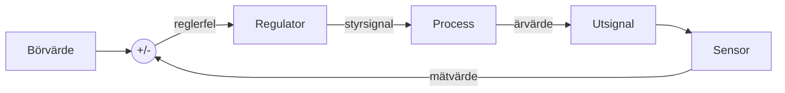

# Kapitel 8: Reglering

> **I det här kapitlet lär du dig**
> - skillnaden mellan öppen styrning och reglering
> - hur en proportionell regulator fungerar
> - varför enbart P-reglering ofta ger ett kvarstående fel
> - vad I- och D-delen gör
> - hur du trimmar en regulator på ett säkert sätt

Tänk på hur du ställer in vattnet i duschen. Du känner att det är för kallt och vrider lite åt varmt. Du väntar, känner igen och vrider lite mindre. Det du gör är **reglering**, och samma princip håller drönare i luften och håller farten i en farthållare.

## Öppen och sluten styrning

| Typ | Hur den fungerar | Exempel | Svaghet |
|---|---|---|---|
| **Öppen styrning** | skickar kommando utan att mäta resultatet | kör motorn i 3 sekunder | störningar märks inte |
| **Sluten reglering** | mäter resultatet och justerar | håll 30 cm till väggen | kräver sensor och kan bli instabil |



**Börvärdet** är det du vill uppnå, **ärvärdet** är det som faktiskt är, och **reglerfelet** e är skillnaden mellan dem. Regulatorns uppgift är att göra felet litet.

## Den enklaste regulatorn: av och på

En **tvålägesregulator** slår på styrsignalen när felet är åt ena hållet och av när det är åt andra hållet. Ett kylskåp fungerar så. Metoden är enkel men gör att ärvärdet pendlar. För en motor betyder det ryckig gång.

## P-reglering

I en **P-regulator** (proportionell) är styrsignalen proportionell mot felet:

$$
u = K_p \cdot e
$$

Är felet stort blir korrigeringen stor. Är felet litet blir korrigeringen liten. Konstanten Kp kallas **förstärkning**.

### Genomgånget exempel: mjuk inbromsning

En bil ska bromsa mjukt framför ett hinder. Stoppavståndet är 0,30 m, högsta farten 0,40 m/s, och K = 2. Farten beräknas så här:

fart = min(0,40, K · (avstånd − 0,30))

| Avstånd (m) | K · (avstånd − stopp) | Fart (m/s) |
|---|---|---|
| 1,00 | 1,40 | 0,40 (begränsad) |
| 0,60 | 0,60 | 0,40 (begränsad) |
| 0,45 | 0,30 | 0,30 |
| 0,35 | 0,10 | 0,10 |
| 0,30 | 0,00 | 0,00 |

Istället för full fart hela vägen fram till hindret saktar bilen ner gradvis. I verkligheten kommer motorn att stanna innan hastigheten går mot noll, eftersom den behöver en minsta styrsignal för att rulla. Det kallas **dödzon** och är något du får kompensera för, ofta genom att skicka en minsta effekt över gränsen.

## Varför P ofta inte räcker

Vi simulerar en robot som ska ställa sig på positionen 0,30 m. En konstant störning, till exempel en sluttande yta, drar den bakåt med 0,10 m/s. Modellen uppdateras tio gånger per sekund med tidssteget dt = 0,1 s: nästa position = position + dt · (u + d).

```python
def simulera(kp, ki, steg=400, dt=0.1, bor=0.30, storning=-0.10):
    x = 0.0
    integral = 0.0
    for _ in range(steg):
        e = bor - x
        integral += e * dt
        u = kp * e + ki * integral
        x += dt * (u + storning)
    return round(x, 4), round(bor - x, 4)

print("P: ", simulera(kp=2.0, ki=0.0))   # (0.25, 0.05)
print("PI:", simulera(kp=2.0, ki=1.0))   # (0.3, -0.0)
```

P-regulatorn stannar på 0,25 m med ett **kvarstående fel** på 0,05 m. Varför? För att hålla emot störningen måste u vara 0,10. Då gäller Kp · e = 0,10, alltså e = 0,10 / 2 = 0,05 m. En P-regulator behöver alltså ett fel för att ge någon styrsignal alls.

Du kan läsa de första stegen för P-regulatorn så här:

| Steg | Position x (m) | Fel e (m) | u = 2 · e (m/s) |
|---|---|---|---|
| 0 | 0,000 | 0,300 | 0,600 |
| 1 | 0,050 | 0,250 | 0,500 |
| 2 | 0,090 | 0,210 | 0,420 |
| 3 | 0,122 | 0,178 | 0,356 |

Så här räknas steg 1: x = 0 + 0,1 · (0,6 − 0,1) = 0,05.

## I och D

**I-delen** (integrerande) lägger ihop felet över tid. Så länge ett fel finns kvar växer bidraget, och det tar bort det kvarstående felet. Simuleringen ovan visar det: med PI-regulatorn hamnar roboten på 0,30 m. Risken är **integrator-uppvridning**: om styrsignalen slagit i taket fortsätter summan att växa och roboten skjuter över målet. Sätt därför ett tak för integralen.

**D-delen** (deriverande) reagerar på hur snabbt felet ändras. Den fungerar ungefär som en broms och dämpar rörelsen när roboten närmar sig målet. Men den är känslig för brus, så ett mätvärde som hoppar ger stora utslag. Därför filtreras signalen ofta först.

Tillsammans bildar delarna en **PID-regulator**:

$$
u = K_p e + K_i \int e\,dt + K_d \frac{de}{dt}
$$

| Del | Reagerar på | Bra för | Risk |
|---|---|---|---|
| P | felet nu | snabb grundrespons | kvarstående fel, svängningar vid hög förstärkning |
| I | fel över tid | tar bort kvarstående fel | uppvridning, långsamma svängningar |
| D | ändring av felet | dämpar översläng | förstärker brus |

## Stabilitet och fördröjning

Hög förstärkning gör att regulatorn reagerar snabbt, men om den reagerar för hårt kommer roboten att skjuta över målet och börja svänga. Då kallas systemet **instabilt**. Fördröjning gör det hela svårare, eftersom regulatorn agerar på gamla mätvärden. Därför behöver du ofta lägre förstärkning när ett system styrs över ett nätverk.

## Så trimmar du

1. Börja med låg förstärkning och roboten i ett läge där den inte kan skada något.
2. Sätt Ki och Kd till noll. Öka Kp tills svaret är snabbt men inte svänger.
3. Lägg till en liten Ki om det finns ett kvarstående fel. Sätt ett tak.
4. Lägg till Kd om det behövs dämpning, och filtrera sensorn först.
5. Ändra en sak i taget och spara dina värden.

Du behöver inte alltid hela PID. Många robotproblem går bra med bara P eller PI. Välj det enklaste som uppfyller kravet.

## Begrepp

- **Reglering:** styrning som använder mätningar för att justera sig själv.
- **Börvärde:** det värde du vill uppnå.
- **Ärvärde:** det värde som faktiskt är.
- **Reglerfel:** skillnaden mellan börvärde och ärvärde.
- **Förstärkning:** faktor som säger hur kraftigt regulatorn reagerar på felet.
- **Kvarstående fel:** fel som finns kvar när systemet har stabiliserats.
- **Dödzon:** område där styrsignalen är för liten för att ge rörelse.
- **Integrator-uppvridning:** att I-delen växer för mycket när styrsignalen är begränsad.

## Testa dig själv

1. Vad är skillnaden mellan öppen styrning och reglering?
2. Varför ger en P-regulator ofta ett kvarstående fel?
3. Vad händer om förstärkningen blir för hög?
4. Varför gör fördröjning reglering svårare?
5. Varför måste du vara försiktig med D-delen på en brusig sensor?
6. Ge exempel på en regulator i ditt eget vardagsliv.

## Koppling till projektet

Mjuk inbromsning är en av utmaningarna i labb 10 i [Robotmopp](../projekt/robotmopp/README.md). Reglering är också central för robotar som ska hålla balansen, och därmed relevant för [Robotik Hunden](../projekt/hunden/README.md) och [Robot: Humanoiden](../projekt/humanoiden/README.md), där läraren fastställer upplägget.

## Läs mer

- [PID-regulator på Wikipedia](https://sv.wikipedia.org/wiki/PID-regulator), en bra startpunkt som du kontrollerar mot andra källor
- [Labb 10: Autonom bil](https://github.com/abbjetmus/ROS2/blob/main/labs/labb-10-autonom-bil.md)

[← Föregående](07-uppkopplade-system.md) | [Innehåll](../README.md) | [Nästa →](09-kvalitet-och-dokumentation.md)
