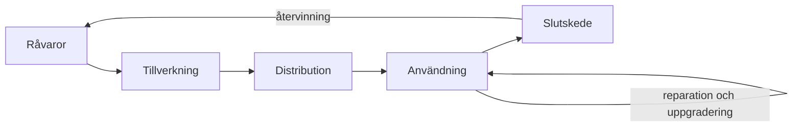

# Kapitel 10: Hållbarhet, regler och teknikens livscykel

> **I det här kapitlet lär du dig**
> - vad hållbar utveckling betyder för smarta system
> - hur du kan tänka kring en produkts hela livscykel
> - hur du beräknar energianvändning och varför viloläge spelar roll
> - vilka lagar och regler som berör området
> - hur ny teknik utvecklas, mognar och fasas ut

En uppkopplad sak består av batteri, kretskort, plast och en tjänst någonstans på nätet. Vad händer med allt det när tjänsten stängs av? Hur hållbar en produkt är avgörs inte bara av hur effektivt den fungerar utan av hela dess liv, från gruvan till återvinningen.

## Tre dimensioner

**Hållbar utveckling** brukar beskrivas med tre dimensioner, och FN:s [Agenda 2030](https://www.globalamalen.se/) samlar mål för dem.

| Dimension | Frågor för smarta system |
|---|---|
| **Ekologisk** | Material, energi, batterier, elavfall |
| **Ekonomisk** | Kostnad över hela livet, reparationer, affärsmodell |
| **Social** | Säkerhet, arbetsmiljö, integritet, vem som gynnas |

En teknisk lösning kan vara bra på en dimension och dålig på en annan. Det är den avvägningen som är intressant.

## Livscykelanalys

En **livscykelanalys** (LCA) undersöker miljöpåverkan från vaggan till graven. Metoden beskrivs i standarden ISO 14040. Även en enkel variant ger bra frågor.

| Fas | Vad du tittar på i en robot |
|---|---|
| Råvaror | metaller i kretskort och batterier, plast |
| Tillverkning | energi vid tillverkning, 3D-utskrifter, spill |
| Distribution | transport av komponenter |
| Användning | strömförbrukning, slitage, programuppdateringar |
| Slutskede | går den att reparera, återanvända eller återvinna? |

För elektronik sker en stor del av miljöpåverkan ofta redan vid tillverkningen. Därför är det ofta bra att få en sak att hålla längre, även om en ny modell skulle dra lite mindre ström. Exakt hur det ser ut måste räknas fram för varje produkt.

### Genomgånget exempel: viloläge

En liten uppkopplad robot drar 5 W när den används, 1 timme per dag under 200 dagar per år. När den inte används är den ändå igång och drar 0,4 W, året runt, eftersom den ska vara nåbar över nätet.

| Del | Beräkning | Energi |
|---|---|---|
| Användning | 5 W · 1 h · 200 | 1000 Wh = 1,0 kWh |
| Viloläge | 0,4 W · 8760 h | 3504 Wh ≈ 3,5 kWh |
| Totalt per år | | ≈ 4,5 kWh |
| Totalt på 5 år | 5 · 4,504 kWh | ≈ 22,5 kWh |

Viloläget står för ungefär 78 % av energin, trots att effekten är låg. Vi räknade viloläget över hela året, vilket ger en grov uppskattning. Slutsatsen är ändå tydlig: ett smart system bör verkligen sova när det inte behövs.

Batteriets kapacitet avgör hur länge en robot kan köra. Ett batteri på 3,7 V och 2,5 Ah rymmer ungefär 3,7 · 2,5 = 9,25 Wh. Två sådana celler ger 18,5 Wh och räcker i teorin 7,4 timmar vid effekten 2,5 W. I praktiken blir tiden kortare.

## Hållbara val i konstruktionen

- **Reparerbarhet:** går det att byta batteri och motor med vanliga verktyg?
- **Modularitet:** kan delar uppgraderas istället för att hela produkten byts?
- **Material:** går det att använda mindre plast och märka delarna för återvinning?
- **Rätt prestanda:** en större dator än som behövs drar mer ström och är dyrare.
- **Mjukvara:** effektiv kod och viloläge sparar energi. Långvariga säkerhetsuppdateringar förlänger livet.
- **Oberoende:** går produkten att använda även om en molntjänst läggs ner?

## Lagar, riktlinjer och standarder

Reglerna för smarta system ändras, och flera av EU:s regelverk införs stegvis. Du behöver inte kunna dem utantill, men du ska veta vad som finns och hur du tar reda på vad som gäller. Sök alltid den aktuella texten från officiell källa när du ska använda en regel på riktigt.

| Regel | Handlar om |
|---|---|
| [Miljöbalken](https://www.riksdagen.se/sv/dokument-och-lagar/dokument/svensk-forfattningssamling/miljobalk-1998808_sfs-1998-808/) | grundläggande hänsynsregler för den som påverkar miljön |
| [WEEE-direktivet](https://eur-lex.europa.eu/eli/dir/2012/19/oj) | insamling och återvinning av elektroniskt avfall |
| [RoHS-direktivet](https://eur-lex.europa.eu/eli/dir/2011/65/oj) | begränsning av farliga ämnen i elektronik |
| [Batteriförordningen](https://eur-lex.europa.eu/eli/reg/2023/1542/oj) | batteriers hållbarhet, märkning och återvinning |
| [Ekodesignförordningen](https://eur-lex.europa.eu/eli/reg/2024/1781/oj) | krav på hållbara produkter |
| [Maskinförordningen](https://eur-lex.europa.eu/eli/reg/2023/1230/oj) | säkerhet för maskiner, ersätter stegvis maskindirektivet |
| [Dataskyddsförordningen, GDPR](https://www.imy.se/) | behandling av personuppgifter, till exempel kamerabilder |
| [AI-förordningen](https://eur-lex.europa.eu/eli/reg/2024/1689/oj) | krav på AI-system utifrån risk |
| [Cyberresiliensförordningen](https://eur-lex.europa.eu/eli/reg/2024/2847/oj) | cybersäkerhet för produkter med digitala delar |
| [Arbetsmiljöverkets regler](https://www.av.se/) | säkerhet och arbetsmiljö, där robotar används på arbetsplatser |

Standarder är tekniska riktlinjer som ofta används för att visa att krav uppfylls. Exempel är ISO 10218 för industrirobotar och ISO 13482 för servicerobotar som arbetar nära människor. Elektronikavfall ska lämnas till särskild insamling, och [Naturvårdsverket](https://www.naturvardsverket.se/amnesomraden/avfall/) beskriver hur avfall hanteras i Sverige.

## Teknikens livscykel

Inte bara produkter har en livscykel utan också tekniker. Spetsteknik är teknik i framkanten, som ofta är dyr och osäker i början.

| Fas | Vad som kännetecknar den |
|---|---|
| **Idé och forskning** | få användare, många förhoppningar |
| **Tidig användning** | dyrt, krångligt, snabba förbättringar |
| **Spridning** | priset sjunker, standarder växer fram |
| **Mognad** | teknik blir vardag, förbättringar blir små |
| **Utfasning** | ersätts av något nytt, support upphör |

Att veta i vilken fas en teknik befinner sig hjälper när du väljer teknik. Väljer du något väldigt nytt kan du få bäst prestanda, men också förändrade gränssnitt och få källor att lära sig av. Väljer du något mycket gammalt riskerar du att reservdelar och uppdateringar försvinner. För uppkopplade produkter betyder utfasning ofta att säkerhetsuppdateringar upphör, vilket gör dem riskabla att ha kvar på nätet. Det gör också elektronik till skrot trots att den fungerar.

## Etiska frågor

Etik handlar om vad vi bör göra, inte bara om vad som går. Några frågor som smarta system väcker:

- Vem bär ansvaret när en autonom robot orsakar en olycka?
- Får en robot i ett hem spela in allt den hör och ser, och vem får se materialet?
- Vad händer med de jobb som ersätts, och vilka nya uppstår?
- Är det rimligt att bygga en produkt med kort livslängd om materialet är sällsynt?
- Hur säkerställer man att ett system inte behandlar människor olika utan skäl?

Det finns sällan ett enkelt svar. Det viktiga är att du kan beskriva vad frågan handlar om, vilka som påverkas och hur du väger olika intressen.

## Begrepp

- **Hållbar utveckling:** utveckling som tillgodoser dagens behov utan att äventyra framtida generationers möjligheter.
- **Livscykelanalys:** bedömning av miljöpåverkan under hela produktens liv.
- **Elavfall:** kasserade elektriska och elektroniska produkter.
- **Producentansvar:** krav på att den som säljer en produkt ansvarar för att den samlas in och återvinns.
- **Reparerbarhet:** hur lätt en produkt kan repareras.
- **Teknikens livscykel:** faserna från forskning till utfasning.
- **Utfasning:** att en teknik gradvis ersätts och slutar stödjas.

## Testa dig själv

1. Ge ett exempel på en robot som är bra för en dimension av hållbarhet men dålig för en annan.
2. Varför sker en stor del av elektronikens miljöpåverkan ofta vid tillverkning?
3. Varför kan viloläge väga tyngre än användning?
4. Vilken regel skulle du behöva titta på om din robot har en kamera? Motivera.
5. Vad är risken med att köpa den allra senaste tekniken? Och med att köpa väldigt gammal teknik?
6. Vad händer med en uppkopplad produkt när säkerhetsuppdateringar upphör?

## Koppling till projektet

Kapitlet är underlag för [Spetsteknikens livscykel](../projekt/spetsteknikens-livscykel/README.md), där läraren fastställer upplägget. Du kan också använda tänket när du väljer komponenter och utvärderar din lösning i [Robotmopp](../projekt/robotmopp/README.md).

## Läs mer

- [Globala målen](https://www.globalamalen.se/)
- [Naturvårdsverket om avfall](https://www.naturvardsverket.se/amnesomraden/avfall/)
- [Integritetsskyddsmyndigheten](https://www.imy.se/)

[← Föregående](09-kvalitet-och-dokumentation.md) | [Innehåll](../README.md)
